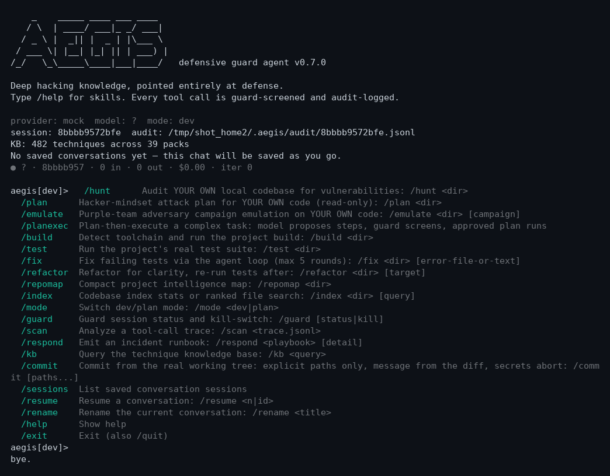

# Aegis — the defensive hacking agent

> Godfather-level hacking knowledge, pointed entirely at defense.

[](LICENSE)
[](pyproject.toml)
[](https://github.com/anilkumara9/aegis/tags)
[](https://github.com/anilkumara9/aegis/pulls)
[](LICENSE)
[](https://github.com/anilkumara9/aegis/graphs/contributors)
[](https://github.com/anilkumara9/aegis/stargazers)

Aegis is a Claude-Code-class terminal agent that knows how hackers think, work, and attack — **386 attack techniques across 31 packs** — and aims that knowledge at exactly one thing: defending your systems. It was born the day after the [OpenCode breach](https://www.cyera.com/blog/opencode-breach-what-happened-and-how-to-rotate-exposed-ai-api-keys) (Oct 2026), where a "large scale distillation attack" exposed developers' AI provider keys. OpenCode's own docs admit its permissions are a UX feature, not a security boundary. Aegis is the opposite: **the guard engine lives inside the agent loop**, and every tool call is screened *before* it executes.

**Defensive only.** Aegis detects, prevents, audits, and remediates. It never generates exploit payloads or malware, never automates unauthorized access, and only ever touches your own local systems. Its knowledge base describes attacks at TTP/detection level — the same level as MITRE ATT&CK.



*Above: a real session. The agent hunts a workspace for exposed secrets — then a planted instruction tries to make it exfiltrate them, and the guard denies the call before anything executes.*

## 60-second quickstart

**Install** — one command, no manual venv steps (isolated venv at `~/.aegis/venv`, `aegis` linked into `~/.local/bin`):

```bash
curl -fsSL https://raw.githubusercontent.com/anilkumara9/aegis/master/install.sh | bash
```

**Verify:**

```bash
aegis version   # -> aegis 0.5.0
```

**Bring a model** — pick one provider (or run fully local/offline):

| Provider  | Env var            | Default model        |
|-----------|--------------------|----------------------|
| anthropic | `ANTHROPIC_API_KEY` | `claude-sonnet-4-5`  |
| openai    | `OPENAI_API_KEY`    | `gpt-4o`             |
| google    | `GOOGLE_API_KEY`    | `gemini-2.0-flash`   |
| ollama    | *(none needed)*     | you pick: `AEGIS_PROVIDER=ollama AEGIS_MODEL=llama3.1` |
| openrouter | `OPENROUTER_API_KEY` | free: `nvidia/nemotron-3-super-120b-a12b:free` |
| mock      | *(none needed)*     | offline demo: `AEGIS_PROVIDER=mock aegis` |

Override the model any time with `AEGIS_MODEL=<name>`. OpenRouter is **free-models-only** — it refuses paid models unless `AEGIS_ALLOW_PAID=1` is set, so your credits are safe.

**First run:**

```bash
aegis
```

You get a chat prompt. Type `/` for the command palette, `@path/to/file` to attach file context, `/sessions` + `/resume <n>` to pick up where you left off. Everything the agent does — sessions, audit logs, watch state, the KB cache — lives in `~/.aegis/`, never in your repo.

A tour of the essentials:

```bash
aegis kb "prompt injection in tool output"   # ask the 386-technique knowledge base
aegis scan examples/opencode_pattern_trace.jsonl  # analyze a tool-call trace
aegis hunt ~/my-project                      # vulnerability triage of YOUR OWN code
aegis watch --once ~/my-project              # continuous monitoring pass + alerts
aegis emulate --target ~/my-project          # purple-team campaign emulation
aegis graph ~/my-project                     # ranked attack paths + breaking defenses
aegis respond rotate-keys openai             # incident runbooks (operator-executed)
```

## Features

- **Agent loop** (`aegis`) — chat-driven terminal agent with streaming, syntax highlighting, sessions that survive restarts, diff previews before file edits are approved, and a slash-command palette. For complex jobs, `/planexec <task>` makes the model propose an explicit step plan, the guard screens every step's shape, you approve it before anything runs, and a verification pass checks the real outcomes (files created, tests green, guard denials disclosed) before the task is declared done — deviations from the approved plan are blocked. `/commit [paths...]` commits from the real working tree: explicit paths only (never blind `git add -A`), message written from the actual diff, staged secrets abort the commit, approval before it lands.
- **In-loop guard** — every tool call passes through allowlist/denylist, dangerous-argument patterns (fork bombs, `rm -rf /`, reverse shells, LOLBin download cradles…), secret redaction on args *and* outputs, egress domain control, and approval escalation — *before* execution. Session taint tracking escalates outbound calls made after sensitive files were read, and multi-step attack chains are caught live, not just in post-mortems.
- **386-technique knowledge base** (`aegis kb "<query>"`) — 31 packs: agent-attack techniques, dark-web threat intel, APT tradecraft from public reporting, ransomware playbooks, web exploitation, C2 operations, cloud attacks, AI-agent attacks, the hacker-tools catalog, attack methodologies, and the hacker-mindset doctrine that shapes the agent's own reasoning.
- **Watch** (`aegis watch --once|--interval|--schedule <dir>`, `aegis watch --triage`) — SOC-in-a-box: change-detected rescans, secret + pattern detection, alert banners, and a severity-ranked, deduped finding queue.
- **Emulate** (`aegis emulate --target <dir>`, `/emulate`) — purple-team adversary emulation: chains KB techniques into multi-stage campaign narratives against your own systems, then verifies each stage would be caught. Plan-level only — nothing is executed, markers are inert.
- **Graph** (`aegis graph <dir>`) — ranked attack paths an adversary would take through your system, each annotated with the defense that breaks it.
- **MCP client** (`aegis mcp list|call`) — connect MCP servers over stdio; every MCP tool call is guard-screened exactly like a native tool. Config: `~/.aegis/mcp.json` (see `docs/MCP_CLIENT.md`).
- **Dev / plan modes** (`--mode dev|plan`, `/mode`) — dev mode has full (guard-screened) power; plan mode is read-only, enforced at the guard layer, not just the prompt. `/plan <dir>` emits a hacker-mindset attack plan for your own code.
- **Defensive inspection arsenal** — read-only local tools wired into the loop: `ps` (process list), `netconns` (connections), `hash` (SHA-256 + integrity baselines), `search` (deep code search). Local-only, guard-screened.

## Knowledge base

`aegis/kb/` holds 31 YAML packs and 386 techniques. Every technique is a condensed threat-intel note: how the attack works, its variants, real-world examples from public incident reports (with references), concrete detection patterns the engine executes, and mitigations. Eight domain specialists (the v0.4 training panel) each deepened one domain: APT campaigns, web attack flows, C2 operations, initial access, cloud attacks, AI-agent attacks, lateral movement, and the cybercrime economy — plus 38 hacker-mindset doctrine notes that teach the agent to reason like an attacker and act like a defender.

Strict schema validation runs on every load (bad packs refuse to load), and a binary cache makes startup instant after the first load. The boundary is absolute: TTP/detection level — how attacks work, what they look like, how to detect and kill them. No payloads, no exploit code, no tool-usage instructions, no access guides. Ever.

## Architecture

```
                        ┌─────────────────────────────┐
                        │        aegis REPL           │
                        │  /hunt /plan /emulate /kb   │
                        │  /planexec /mode /sessions  │
                        │  /commit                    │
                        │  palette, @files, diffs     │
                        └──────────────┬──────────────┘
                                       │ user message
                        ┌──────────────▼──────────────┐
                        │        Agent loop           │
                        │  system prompt ← KB depth   │
                        │  (mindset doctrine + 386    │
                        │   techniques + guard rules) │
                        │  plan-then-execute phase    │
                        └──────────────┬──────────────┘
                                       │ tool call request
                        ┌──────────────▼──────────────┐
                        │      GUARD (in-loop)        │◄── dogfood:
                        │ allow/deny lists, arg rules,│    the agent defends
                        │ secret scan+redaction,      │    itself with the
                        │ egress control, taint       │    same engine
                        │ tracking, live chain        │
                        │ detection, approval, kill   │
                        │ switch                      │
                        └──────────────┬──────────────┘
        ┌──────────────────┬───────────┼───────────┬──────────────────┐
        ▼                  ▼           ▼           ▼                  ▼
  ┌───────────┐     ┌─────────────┐ ┌────────┐ ┌──────────┐    ┌────────────┐
  │  Tools    │     │  Audit log  │ │ Redact │ │ Providers│    │  KB (386)  │
  │ bash, read│     │ JSONL, every│ │ at EVERY│ │Anthropic │    │ 31 packs,  │
  │ write/edit│     │ call, args+ │ │ return │ │OpenAI    │    │ cached,    │
  │ ps, hash, │     │ output      │ │boundary│ │Google    │    │ validated  │
  │ netconns, │     │ redacted    │ │        │ │Ollama    │    └────────────┘
  │ search,   │     └─────────────┘ └────────┘ │mock      │
  │ webfetch, │     ┌─────────────┐            └──────────┘
  │ kb_query, │     │ Subsystems  │
  │ scan_trace│     │ scan/hunt/  │
  │ respond,  │     │ watch/      │
  │ MCP tools │     │ emulate/    │
  └───────────┘     │ graph       │
                    └─────────────┘
```

## Honest scope

- Aegis cannot protect keys **already stolen** before deployment.
- It cannot see inside encrypted channels it doesn't terminate.
- Human-approval fatigue is a residual risk — the guard escalates, the human must still judge.
- `/hunt`, `watch`, and `graph` are triage, not proofs of security. `/emulate` is plan-level narrative, not a live attack.
- Mock provider is for tests and demos; real work needs your own API key (or a local model).
- Full ceiling: `docs/SCOPE_AND_LIMITS.md`. Threat model: `SECURITY.md`.

## Project progress

| Milestone | Status | Shipped |
|---|---|---|
| v0.1.0 — first agent | ✅ done | REPL agent loop, 212-technique KB (19 packs), in-loop guard, scan/respond, 106 tests |
| v0.2.0 — OpenCode parity push | ✅ done | Gap analysis vs OpenCode, 252 techniques (23 packs), sessions/palette/diffs, `aegis watch` SOC-in-a-box, 241 tests |
| v0.3.0 — model-agnostic + one command | ✅ done | Google + Ollama providers, dev/plan modes, polished TUI, `install.sh` single-command setup, 291 tests |
| v0.4.0 — Godfather Program | ✅ done | 8-specialist training panel → 386 techniques (31 packs); `aegis emulate`, `aegis graph`, MCP client; 576 tests |
| v0.5.0 — god-level power | ✅ done (current) | Inspection arsenal (ps/netconns/hash/search), plan-then-execute, guard hardening (taint + live chains + reverse-shell rules), KB binary cache, 600 tests |

Progress to 1.0: ██████████░░░░░░░░ — the agent is real, tested, and installs with one command. Stars and contributors below are the fuel for what comes next.

## Development

```bash
git clone https://github.com/anilkumara9/aegis.git
cd aegis && python3 -m venv .venv && .venv/bin/pip install -e ".[dev]"
.venv/bin/python -m pytest tests/ -q   # full suite, no network
```

Engineering law: every capability is wired into the CLI and covered by real tests — no stubs, no demo systems. See `PROJECT_BRIEF.md` for the build spec and `docs/SCOPE_AND_LIMITS.md` for the defensive boundary.

## Contributors

Aegis is built in the open — every contribution counts, from a typo fix to a whole new detection pack. PRs are welcome.

<a href="https://github.com/anilkumara9/aegis/graphs/contributors">
  
</a>

## ⭐ Stars

If Aegis helps you defend something, star it — it helps others find it.

[](https://github.com/anilkumara9/aegis/stargazers)

[](https://star-history.com/#anilkumara9/aegis&Date)
